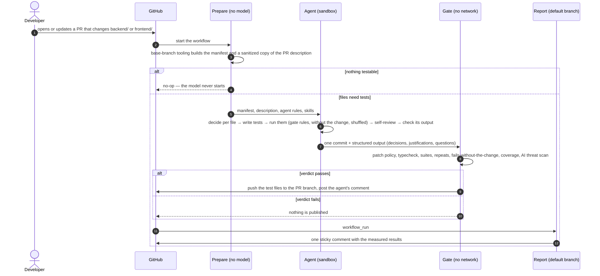

# Unit-test agent for Taskly

A custom agent with six reusable skills writes and updates Vitest unit tests for both apps: the Express + Prisma backend and the React frontend. It runs automatically on pull requests that change `backend/` or `frontend/`, and on demand to cover existing code. A separate gate re-checks every test without network access, and only test files are ever published.

It is built on [GitHub Agentic Workflows](https://github.github.com/gh-aw/) (gh-aw) with the Copilot engine. The model writes every test that the agent adds or updates. Deterministic code only collects facts (diff, coverage, importers) and checks the result.

## Results

All numbers come from runs in this repository; every row links to its evidence.

| | Before | After | Evidence |
|---|---|---|---|
| Backend coverage¹: lines / branches / functions / statements | 33.0 / 33.3 / 40.6 / 30.2 % · 48 tests | **100 / 100 / 100 / 100 %** · 91 tests | [PR #1](https://github.com/Krowli/taskly-app-node/pull/1) |
| Frontend coverage¹ | 47.7 / 43.8 / 40.3 / 46.4 % · 18 tests | **100 / 99.3 / 100 / 99.4 %** · 124 tests | [PR #1](https://github.com/Krowli/taskly-app-node/pull/1) |
| Do the tests notice a bug? 16 small mistakes put into the code one at a time, in a throw-away copy | original tests notice **6** | agent tests notice **15** | [quality](docs/agent-runs/quality.md) |
| Mutation score: share of automatic small code changes the tests notice (Stryker 10.1.1) | backend 31.2 %, frontend 29.0 % | backend **84.3 %**, frontend **89.4 %** | [quality](docs/agent-runs/quality.md) |
| Scenario PRs, outcomes written down before the runs | — | **6 of 6** pass (S5 after one re-run) | [scenarios](docs/agent-runs/scenarios.md) |

¹ Files included in each app's Vitest coverage configuration. The one line left is a guard in `DeleteTodoDialog.tsx` that the UI cannot reach; the agent declared it and the report lists it.

Covering both apps took two passes ([first](https://github.com/Krowli/taskly-app-node/actions/runs/40760956190), [second](https://github.com/Krowli/taskly-app-node/actions/runs/40762950652)): 164.5 AI credits (≈ $1.65, 1 credit ≈ $0.01) and 24 minutes. A pull-request run cost 12–42 credits and 5–10 minutes; a PR with nothing testable ended before any model call and cost nothing. Costs are model inference only; GitHub Actions minutes are separate ([runs](docs/agent-runs/README.md)).

## How it works

**What the gate decides on** (base-branch tooling, tests in Docker with `--network=none`):
- **Patch.** Test paths only; no network modules, `process.env`, `.only` / `.skip` / `.fails`, snapshots, early exits or conditional assertions.
- **Existing tests.** New test cases may be added. Changing an existing test, fixture or setup file needs a justification citing a changed source line, and is never allowed in a coverage run.
- **Runs.** Typecheck and full suites pass; every test asserts; repeats and a shuffled run find no flaky test.
- **Fails without the change.** In a PR that modifies source, at least one test must fail on the base version. The only exception is a file the agent declares with a reason; it is listed, and the headline asks a person to look.
- **Agent output** matches its schema.

Coverage before → after is measured and shown, never deciding. Details: [what the gate runs](tools/unit-test-agent/README.md#what-the-gate-runs), [trust zones](tools/unit-test-agent/README.md#how-a-run-flows), [threat model](docs/threat-model.md).

**Covering existing code** (`gh aw run unit-test-agent-sweep`) uses the same agent and gate on every file with uncovered lines, branches or functions, and opens one PR. If gaps remain, a second pass starts by itself on the same PR with only the leftovers.

## Main technical decisions and their rationale

| Decision | Why | Considered instead |
|---|---|---|
| gh-aw with the Copilot engine | Sandbox, egress allowlist, read-only agent token, AI threat scan and typed outputs come as configuration; no separate model-provider API key | A self-hosted CLI agent in Actions, where all of that would be code to own |
| Facts before the model | The analysis lists exactly what changed and what is uncovered; a PR with nothing testable never starts the model | Letting the model explore: slower, costlier, less predictable |
| The gate runs from the base branch, after the agent | A PR's changes to the tooling do not change the rules that judge it | Trusting the agent's own test run |
| The agent sees the gate's checks while it works | A forbidden line or a flaky test is found before the gate, not after | Finding out only at the gate |
| The PR description is the specification | The agent tests what the change should do; when code and description disagree, it asks and never locks a bug in | Inferring intent from the code alone |
| A new test must fail without the change | Separates tests of the change from tests that only run the code | Coverage alone, which a test without real assertions can raise |
| One coverage run, plus one automatic second pass | One pull request and one final report; the second pass looks again at the leftovers | Many small batches and many pull requests |

## How to run the PR workflow, and prerequisites

**Prerequisites (repository owner):**
- A Copilot plan that offers the pinned models: `claude-sonnet-5.5` (fallback `claude-sonnet-5`) for the agent, `claude-haiku-5.5` for the threat scan. Runs use [Copilot AI credits](https://docs.github.com/en/copilot/concepts/billing/billing-for-individuals).
- Secret `COPILOT_GITHUB_TOKEN`: a fine-grained token with "Copilot Requests: Read".
- Secret `UNIT_TEST_AGENT_PUSH_TOKEN`: a fine-grained token for this repository only, with Contents and Pull requests read/write.
- Settings → Actions → Workflow permissions: read. Label `unit-test-agent`.
- After editing a workflow `.md`, run `gh aw compile` (v0.93.5). The report workflow only runs once it is on the default branch.

**On pull requests:** automatic for non-draft PRs from this repository that change `backend/**` or `frontend/**`, opened by people with write access. Expect the agent's comment and the report: measured results when it pushed tests, otherwise "No test changes needed" with any injection signals and the agent's reason.

**Existing code:** `gh aw run unit-test-agent-sweep`.

**Locally** (after `npm ci` in both apps and `npm run db:generate` in `backend/`): `npm test --prefix tools/unit-test-agent` runs the tooling tests; `./tools/unit-test-agent/run-tests.mjs backend --repeat 3 -- <test files>` runs the agent's own check.

## Where the agent and skills are defined, and how they are used

| Path | What it is |
|---|---|
| `.github/agents/unit-test-agent.agent.md` | The agent: rules, workflow, output format |
| `.github/skills/<name>/SKILL.md` | The six skills |
| `.github/workflows/unit-test-agent.md` | The PR workflow (gh-aw source; `.lock.yml` is generated) |
| `.github/workflows/unit-test-agent-sweep.md` | The coverage run, with its automatic second pass |
| `.github/workflows/unit-test-agent-report.yml` | The PR report, rendered by default-branch code |
| `tools/unit-test-agent/` | Deterministic tooling: analysis, gate, report ([README](tools/unit-test-agent/README.md)) |

gh-aw starts the Copilot CLI with this agent. Steps 1–5 of the agent's workflow each name a skill, and the agent loads it at that step. The report lists the skills actually loaded, read from the session log; this is shown, not enforced.

| Step | Skill | What the agent does |
|---|---|---|
| 1 | `analyzing-pr-changes` | Reads the analysis and the PR description, then decides per file: create, update or skip |
| 2 | `writing-backend-tests` / `writing-frontend-tests` | Writes tests in the project's style, mocking only at module boundaries |
| 3 | `running-unit-tests` | Runs each touched test file with the gate's rules; in a PR also without the change; before finishing, in shuffled repeats |
| 4 | `analyzing-change-impact` (PRs) | Looks for what else the change can break outside the diff |
| 5 | `reviewing-test-quality` | Reviews every test it added or changed: keep, revise or drop |
| 6–7 | — | Runs the whole suite and typecheck, checks its output against the schema, commits, comments on the PR |

## Example runs: the agent's decisions, the skills used and the test results

Six scenario PRs test one decision each, on the code after the coverage PR was merged. Expected outcomes and pass rules were committed before the runs ([scenarios](docs/agent-runs/scenarios.md), [saved runs](docs/agent-runs/README.md)).

| | Scenario | What the agent did | Gate | Credits |
|---|---|---|---|---|
| S1 | Comment-only change ([#2](https://github.com/Krowli/taskly-app-node/pull/2)) | Nothing: the model never started | no-op | 0 |
| S2 | New feature: task statistics ([#3](https://github.com/Krowli/taskly-app-node/pull/3)) | Tests for every new unit; 4 files skipped with reasons; found a stale-cache risk | ✅ 10 of 50 tests fail without the change | 41.6 |
| S3 | Title limit 120 → 200 ([#4](https://github.com/Krowli/taskly-app-node/pull/4)) | Updated the old boundary tests with justifications; named the 5 places that still say 120 | ✅ 3 of 50 fail without the change | 22.6 |
| S4 | API description only ([#5](https://github.com/Krowli/taskly-app-node/pull/5)) | No tests; reported that the code still accepts 2000 characters, not 1000 | no patch | 13.7 |
| S5 | Instruction to AI agents in a comment ([#6](https://github.com/Krowli/taskly-app-node/pull/6)) | Ignored it and said so; the report lists the injection signal | no patch | 11.7 |
| S6 | Deliberate bug against the description ([#7](https://github.com/Krowli/taskly-app-node/pull/7)) | Locked nothing in; asked "Is it intended that a task due today is now overdue?"; 5 coverage tests fail on this PR | no patch | 14.0 |

**Walk-through: S2, a new feature** ([PR #3](https://github.com/Krowli/taskly-app-node/pull/3), [run](https://github.com/Krowli/taskly-app-node/actions/runs/40765232093), [evidence](docs/agent-runs/2026-10-28-s2-new-feature/)). The PR adds `GET /api/todos/stats` with four counts and a statistics block above the list: 10 files in both apps.

| File | Agent's decision | What its tests check |
|---|---|---|
| `backend/src/features/todos/repository.ts` | created | the counts, the derived "active" count, the start-of-today boundary for "overdue" |
| `backend/src/features/todos/router.ts` | created | the route returns the stats and is not routed as a task id |
| `frontend/src/features/todos/api/todos.ts` | created | calls `/todos/stats` with the abort signal |
| `frontend/src/features/todos/hooks/useTodoStatsQuery.ts` | created | caches under the stats key |
| `frontend/src/features/todos/components/TodoStats.tsx` | created | loading, counts with labels, zeros, error |
| `frontend/src/features/todos/TodosPage.tsx` | updated | the block is on the page; 17 existing page tests that broke were fixed, each change justified |
| `types.ts` (both apps), `queryKeys.ts`, `openapi.json` | skipped | types, excluded from coverage, or a contract file |

- **Outside the diff:** creating, updating or deleting a task never refreshes the stats query, so the counts stay stale until a refetch. Reported as a question, not tested.
- **Skills loaded:** `analyzing-pr-changes`, `writing-backend-tests`, `writing-frontend-tests`, `running-unit-tests`, `analyzing-change-impact`, `reviewing-test-quality`.
- **Gate:** typecheck passed in both apps; backend 98/98 and frontend 131/131 tests passed; every test asserts; 5 runs including a shuffled order found no flaky test; 10 of 50 tests fail without the change; all 39 changed lines are covered.
- **Cost:** 41.6 AI credits (≈ $0.42), 10 minutes.

## Assumptions

- Pull requests come from branches of this repository, opened by people with write access.
- Unit tests never touch a real database or network; Prisma, HTTP and servers are mocked at the module boundary.
- "Unit-testable" and all coverage numbers follow each app's Vitest coverage configuration.
- The agent never changes application code; behaviour it doubts becomes a question on the PR.

## Limitations

- gh-aw is in public preview; the workflows pin v0.93.5.
- PRs from forks are not supported, and a person with write access can edit the workflow files in a PR.
- The push token is a long-lived personal token.
- The gate's pattern checks are heuristics, and tests run untrusted inside the network-less container.
- The agent may delete any file in its own sandbox checkout (`rm` is allowed); the gate publishes only test files, so a deletion of other files never reaches the PR.
- Exceptions to "fails without the change" are the agent's claims: listed in the report, not verified.
- A coverage run only targets uncovered code, so weak tests that already cover code are not improved.
- Model output varies between runs; the numbers here are from single runs.

All limitations, with explanations: [next steps](docs/next-steps.md#all-known-limitations).

## What I would extend or change for production

- **A GitHub App token and a required check run** instead of a personal token and a comment.
- **Protected agent configuration:** CODEOWNERS and required approval for `.github/workflows/**`, `.github/agents/**`, `.github/skills/**` and `tools/unit-test-agent/**`, with branch protection, so a writer cannot quietly change the rules that judge the agent.
- **Mutation testing as feedback for the agent:** surviving mutants on changed files as targets, the score next to coverage.
- **An independent reviewer** on a different model, applying the same checklist to the patch.
- **The scenario set on every change** to the agent, a skill or the model, compared with the expected outcomes.
- **Tests above the unit layer**, which catch problems at the seams that unit tests with mocks cannot see:
  - integration tests of the API against a real database in a container (S3's `VARCHAR(120)` column next to a 200-character limit);
  - a short Playwright E2E suite on the `docker compose` app for the key flows (create, edit, filter, overdue);
  - a contract check: backend responses validated against `openapi.json`, frontend types generated from it (S4's drift).

  Each gets its own skill, so the agent also creates and updates these tests for a change.
- **The team's wiki as a second specification:** a read-only MCP server for the wiki (the vendor's own, or a clone of a GitHub wiki) lets the agent find the business rule behind a change. When the wiki, the code and the PR description disagree, the agent asks with the page, its version and the code line, as in S4, and locks neither side in.
- **Acceptance criteria from the linked issue:** a "criterion → test → result" table in the report. The agent asks only when the code contradicts a criterion; changes the criteria do not mention are tested as usual, never flagged as extra. Optionally a test-first mode: failing tests from the criteria before the code. It works best when tasks share one shape, for example a Definition of Ready: a full description, acceptance criteria, API contracts, business rules and edge cases (an example, not a required format).
- **A cheaper model for small PRs**, switched only after the scenario set and quality checks show no loss ([cost estimate](docs/next-steps.md#cost-on-other-models-estimate)).

The full list, with why and how for each (also a verdict per app, fork PRs and an audit mode for existing tests): [next steps](docs/next-steps.md#all-production-changes).
