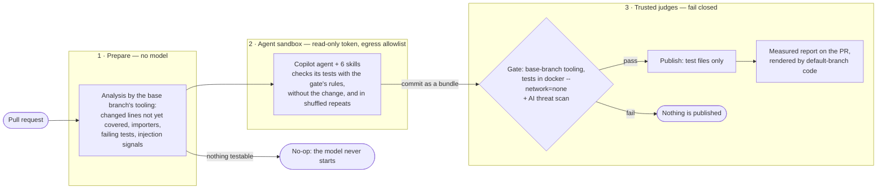
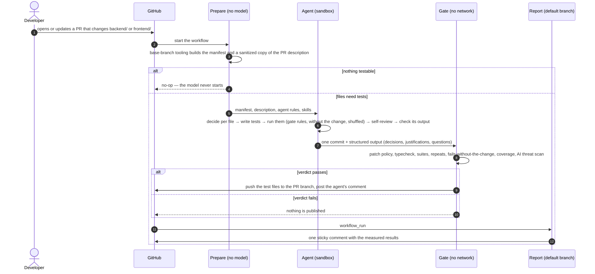
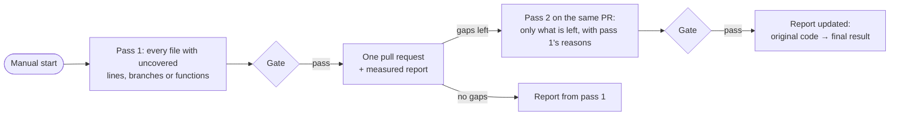

# Unit-test agent for Taskly

A custom agent with six reusable skills writes and updates Vitest unit tests for both apps: the Express + Prisma backend and the React frontend. It runs automatically on pull requests that change `backend/` or `frontend/`, and on demand to cover existing code. A separate gate re-checks every test without network access before anything is published.

It is built on [GitHub Agentic Workflows](https://github.github.com/gh-aw/) (gh-aw) with the Copilot engine. The model writes every test that the agent adds or updates. Deterministic code only collects facts (diff, coverage, importers) and checks the result.

## Results

All numbers below come from runs in this repository; every row links to its evidence.

| | Before | After | Evidence |
|---|---|---|---|
| Backend coverage¹: lines / branches / functions / statements | 33.0 / 33.3 / 40.6 / 30.2 % · 48 tests | **100 / 100 / 100 / 100 %** · 91 tests | [PR #1](https://github.com/Krowli/taskly-app-node/pull/1) |
| Frontend coverage¹ | 47.7 / 43.8 / 40.3 / 46.4 % · 18 tests | **100 / 99.3 / 100 / 99.4 %** · 124 tests | [PR #1](https://github.com/Krowli/taskly-app-node/pull/1) |
| Do the tests notice a bug? 16 small mistakes put into the code one at a time, in a throw-away copy | original tests notice **6** | agent tests notice **15** | [quality](docs/agent-runs/quality.md) |
| Mutation score: share of automatic small code changes the tests notice (Stryker 10.1.1) | backend 31.2 %, frontend 29.0 % | backend **84.3 %**, frontend **89.4 %** | [quality](docs/agent-runs/quality.md) |
| Scenario PRs, outcomes written down before the runs | — | **6 of 6** pass (S5 after one re-run) | [scenarios](docs/agent-runs/scenarios.md) |

¹ Files included in each app's Vitest coverage configuration. The one line left is a guard in `DeleteTodoDialog.tsx` that the UI cannot reach (the button is disabled while a delete is pending); the agent declared it and the report lists it.

Covering both apps took two passes ([first](https://github.com/Krowli/taskly-app-node/actions/runs/40760956190), [second](https://github.com/Krowli/taskly-app-node/actions/runs/40762950652)): 116.5 + 48.0 = 164.5 AI credits (≈ $1.65), 14 + 10 minutes. A pull-request run cost 12–42 credits (≈ $0.12–0.42) and 5–10 minutes; a PR with nothing testable ended before any model call and cost nothing ([runs](docs/agent-runs/README.md)).

## How it works

The model proposes and deterministic code decides. A run passes through three zones. No zone holds untrusted input, a secret and write access at the same time.

**One pull-request run, step by step:**

**What the gate checks.** These checks decide the verdict:
- **Paths and patterns.** The patch touches test paths only. It has no forbidden patterns: network modules, `process.env`, `.only` / `.skip` / `.fails`, snapshots.
- **No weakening.** Weakening patterns are rejected in any added test code: an early exit, assertions only inside a condition or a `catch`, a swallowed failure. These are line-based heuristics.
- **Existing tests.** New test cases may be added to existing test files in both modes. Changing an existing test case, a shared fixture or a setup file needs, in a PR, a justification that cites a changed source line; in a coverage run it is not allowed.
- **Runs.** Each app is typechecked once. The full suite runs once with coverage. For each app whose test files the agent changed, the full suite runs once more in shuffled order, and the agent's test files run 4 more times: once with every test required to assert, then 3 plain repeats. All of these must pass.
- **Fails without the change.** If a PR modifies existing source code, at least one new test must fail when those files are put back to their base version. The exception is a modified file for which the agent declares a reason (no behaviour change, suspected bug, not unit-testable). These exceptions are listed in the report, and when a PR passes only through them, the report's headline asks a person to look.

**Agent output.** The agent's structured output (decisions, justifications, exceptions) is checked against its schema, by the agent before it commits and by the gate. A mismatch is shown in the report; a justification or exception the gate cannot read counts as missing.

**Measured and shown, never deciding:** coverage before → after on four metrics, for the files included in each app's Vitest coverage configuration.

**Covering existing code** works the same way, but is started by hand. The analysis lists every file with uncovered lines, branches or functions. A run has up to two passes:

## Where things live

| Path | What it is |
|---|---|
| `.github/agents/unit-test-agent.agent.md` | The agent: rules, workflow, report format |
| `.github/skills/` | The six skills, one folder each (see the table below) |
| `.github/workflows/unit-test-agent.md` | The PR workflow (gh-aw source; `.lock.yml` is generated) |
| `.github/workflows/unit-test-agent-sweep.md` | Coverage of existing code, with an automatic second pass on the same PR |
| `.github/workflows/unit-test-agent-report.yml` | The measured PR comment, rendered by default-branch code |
| `tools/unit-test-agent/` | Deterministic tooling: analysis, gate, report ([README](tools/unit-test-agent/README.md)) |
| `docs/threat-model.md` | What is trusted, what is not, and the remaining risks |
| `docs/agent-runs/` | Saved runs and the scenario set with outcomes written down in advance |

**How the agent uses the skills.** gh-aw starts the Copilot CLI with this agent. Steps 1–5 of the agent's workflow each name a skill, and the agent loads it when that step starts. The report lists the skills that were actually loaded, read from the session log. This is shown, not enforced.

| Step | Skill | What the agent does |
|---|---|---|
| 1 | `analyzing-pr-changes` | Reads the analysis and the PR description, then decides per file: create, update or skip |
| 2 | `writing-backend-tests` / `writing-frontend-tests` | Writes tests in the project's style, mocking only at module boundaries |
| 3 | `running-unit-tests` | Runs each touched test file and checks it with the gate's rules. In a PR it also runs the tests without the change; before finishing, in shuffled repeats. |
| 4 | `analyzing-change-impact` (PRs) | Looks for what else the change can break outside the diff |
| 5 | `reviewing-test-quality` | Reviews every test it added or changed: keep, revise or drop |
| 6 | (as in `running-unit-tests`) | Runs the whole suite and the typecheck once for each app it touched |
| 7 | — | Writes its structured output, checks it against the schema (`run-tests.mjs --check-output`), commits, and comments on the PR |

## Main decisions

| Decision | Why | Considered instead |
|---|---|---|
| gh-aw with the Copilot engine | Sandbox, egress allowlist, read-only agent token, AI threat scan and typed outputs come as configuration. Model access goes through the Copilot subscription, so no separate model-provider API key is needed. | A self-hosted CLI agent in Actions, where the sandbox, hooks and runner would be code to own |
| Facts before the model | The analysis lists exactly what changed and what is uncovered. A PR with nothing testable never starts the model. | Letting the model explore, which is slower, costlier and less predictable |
| Gate in the threat-detection job, from the base branch | Changes a PR makes to the tooling do not change the rules that judge it, and nothing from the agent runs before its paths are validated. A writer can still edit the workflow file itself; see Limitations. | Trusting the agent's own test run |
| The agent sees the gate's checks while it works | Its test command applies the gate's own patch rules, runs its tests without the change, and repeats them in shuffled order. A single forbidden line or flaky test is found before the gate. | Finding out only at the gate |
| The PR description is the specification, passed as a sanitized file | The agent tests what the change should do. When code and description disagree, it asks and never locks a bug in. | Inferring intent from the code alone |
| A new test must fail without the change | Separates tests of the change from tests that only run the code | Coverage alone, which a test without real assertions can raise |
| One coverage run per request, plus one automatic second pass on what is left | One pull request and one final report. The second pass gets a fresh look at the leftovers. | Many small batches and many pull requests |

## Running it

**Prerequisites (repository owner):**
- A Copilot plan that offers the pinned models: `claude-sonnet-5.5` (fallback `claude-sonnet-5`) for the agent, `claude-haiku-5.5` for the threat scan. Runs use [Copilot AI credits](https://docs.github.com/en/copilot/concepts/billing/billing-for-individuals).
- Secret `COPILOT_GITHUB_TOKEN`: a fine-grained token with "Copilot Requests: Read".
- Secret `UNIT_TEST_AGENT_PUSH_TOKEN`: a fine-grained token for this repository only, with Contents and Pull requests read/write. If the repository is recreated, the token must be given access to the new one.
- Settings → Actions → Workflow permissions: read.
- Label `unit-test-agent`.
- After editing a workflow `.md`, run `gh aw compile` (v0.93.5). The report workflow (`workflow_run`) only runs once it is on the default branch.

**On pull requests:** runs automatically for non-draft PRs from this repository that change `backend/**` or `frontend/**`, opened by people with write access. To check the setup, change one line of a function in `backend/src`. Expect the agent's comment and the report: measured results when it pushed tests; otherwise, if the model ran, "No test changes needed" with the injection signals and the agent's no-op reason.

**Existing code:** `gh aw run unit-test-agent-sweep` covers both apps and opens one pull request. If gaps remain, a second pass starts by itself.

**Locally** (after `npm ci` in both apps and `npm run db:generate` in `backend/`):
- `npm test --prefix tools/unit-test-agent` runs the tooling tests.
- `./tools/unit-test-agent/run-tests.mjs backend --repeat 3 -- <test files>` runs the agent's own check.

## Example runs

Six scenario PRs test one decision each, on the code after the coverage PR was merged. Their expected outcomes and pass rules were committed before the runs ([scenarios](docs/agent-runs/scenarios.md), [saved runs](docs/agent-runs/README.md)).

| | Scenario | What the agent did | Gate | Credits |
|---|---|---|---|---|
| S1 | Comment-only change ([#2](https://github.com/Krowli/taskly-app-node/pull/2)) | Nothing: the analysis found no testable change and the model never started | no-op | 0 |
| S2 | New feature: task statistics ([#3](https://github.com/Krowli/taskly-app-node/pull/3)) | Tests for the new repository method, route, API call, hook, component and page; 4 files skipped with reasons; found that the stats cache is never refreshed after a change | ✅ 10 of 50 tests fail without the change | 41.6 |
| S3 | Title limit 120 → 200 ([#4](https://github.com/Krowli/taskly-app-node/pull/4)) | Updated the old boundary tests, each change justified by the changed line; added 121 / 200 / 201; named the 5 places that still say 120 | ✅ 3 of 50 fail without the change | 22.6 |
| S4 | API description only ([#5](https://github.com/Krowli/taskly-app-node/pull/5)) | No tests; reported that the code still accepts 2000 characters while the description says 1000 | no patch | 13.7 |
| S5 | Instruction to AI agents hidden in a comment ([#6](https://github.com/Krowli/taskly-app-node/pull/6)) | Ignored it and said so without quoting it; no tests needed; the report lists the injection signal | no patch | 11.7 |
| S6 | Deliberate bug against the description ([#7](https://github.com/Krowli/taskly-app-node/pull/7)) | Wrote no test that locks the bug in; asked "Is it intended that a task due today is now overdue?" and named the 5 coverage tests that fail on this PR | no patch | 14.0 |

**Walk-through: S2, a new feature** ([PR #3](https://github.com/Krowli/taskly-app-node/pull/3), [run](https://github.com/Krowli/taskly-app-node/actions/runs/40765232093), [evidence](docs/agent-runs/2026-10-28-s2-new-feature/)).

- **What changed.** `GET /api/todos/stats` with four counts, and a statistics block above the list: 10 files in both apps.
- **What the agent decided** (from its structured output):

  | File | Decision | Tests |
  |---|---|---|
  | `backend/src/features/todos/repository.ts` | created | counts, the derived "active" count, the start-of-today boundary for "overdue" |
  | `backend/src/features/todos/router.ts` | created | the route returns the stats and is not routed as a task id |
  | `frontend/src/features/todos/api/todos.ts` | created | calls `/todos/stats` with the abort signal |
  | `frontend/src/features/todos/hooks/useTodoStatsQuery.ts` | created | caches under the stats key |
  | `frontend/src/features/todos/components/TodoStats.tsx` | created | loading, counts with labels, zeros, error |
  | `frontend/src/features/todos/TodosPage.tsx` | updated | the block is on the page; 17 existing page tests that broke were fixed, each change justified |
  | `types.ts` (both apps), `queryKeys.ts`, `openapi.json` | skipped | types, excluded from coverage, or a contract file |

- **What it found outside the diff.** Creating, updating or deleting a task never refreshes the stats query, so the counts stay stale until a refetch. Reported, not tested: it is a question for the author.
- **Skills it loaded:** `analyzing-pr-changes`, `writing-backend-tests`, `writing-frontend-tests`, `running-unit-tests`, `analyzing-change-impact`, `reviewing-test-quality`.
- **What the gate measured:**
  - typecheck passed in both apps;
  - backend 98/98 and frontend 131/131 tests passed;
  - every test has an assertion, and 5 runs including a shuffled order found no flaky test;
  - 10 of 50 tests fail without the change;
  - all 39 changed lines are covered.
- **Cost:** 41.6 AI credits (≈ $0.42), 10 minutes.

## Assumptions

- Pull requests come from branches of this repository, opened by people with write access.
- Unit tests never touch a real database or network. Prisma, HTTP and servers are mocked at the module boundary.
- "Unit-testable" and all coverage numbers follow each app's Vitest coverage configuration. Types, stories and the design system are excluded where that configuration excludes them.
- The agent never changes application code. Behaviour it doubts becomes a question on the PR.

## Limitations

- gh-aw is in public preview; the workflows pin v0.93.5.
- PRs from forks are not supported. PR code also runs before the agent (dependency install without scripts, client generation, the baseline run). That is acceptable only because only writers can trigger it.
- A person with write access can edit the workflow files in a PR. The design protects against the agent and accidental edits, not against a malicious maintainer.
- The push token is a long-lived personal token.
- The gate runs untrusted test code in a network-less container. A test can forge the measurement files it writes. Trusted code checks only the patch and the shape of those files.
- The pattern and weakening checks are heuristics, not a sandbox.
- Exceptions to "fails without the change" are the agent's own claims. The gate lists them in the report but cannot verify them.
- "Fails without the change" counts every test in the test files the agent touched, so it shows that the patch's files detect the change, not which new test does.
- Model output varies between runs, so the numbers in `docs/agent-runs/` are from single runs.
- A coverage run only targets uncovered code. Weak tests that already cover code are not improved.
- The AI threat scan can block a correct run when the PR itself contains injected text. That is safe, but nothing from that run is published.
- Each run uses Copilot AI credits and GitHub Actions minutes. When the credits run out, the model returns HTTP 429 and the run fails until the allowance resets or a budget is set. See GitHub's terms for [Copilot](https://docs.github.com/en/copilot/concepts/billing/billing-for-individuals) and [Actions](https://docs.github.com/en/billing/concepts/product-billing/github-actions).

## What I would change for production

| Change | Why | How |
|---|---|---|
| **Mutation testing as a tool for the agent** | Coverage shows that code ran. Mutation testing shows that a test would catch a change to it. | Stryker (`@stryker-mutator/core` + `@stryker-mutator/vitest-runner`), installed only under `tools/unit-test-agent`. Run with `--mutate` on the changed files and `--incremental`. Show surviving mutants to the agent as targets, and the score next to coverage. |
| **An independent reviewer** | Today the self-review is the same model judging its own work | A second, read-only agent on a different model applies the same checklist to the patch; its verdict appears in the report |
| **Apply by label** | Some teams want a human click before tests land | The verified patch is offered on the PR; a label commits it against the expected head commit |
| **GitHub App token and a required check run** | A personal token is long-lived and tied to one person, and a comment is not a merge gate | A short-lived App token for pushes; results as a check run with annotations, required by branch protection |
| **The scenario set on every change** | Shows at once whether a change to the agent, a skill or the model made decisions worse | Re-run S1–S6 automatically and compare with the expected outcomes |
| **A verdict per app** | Today one failing frontend test rejects the backend tests from the same run | Judge and publish backend and frontend patches separately |
| **PRs from forks** | PR code runs in the agent job today | Move that step into a separate job with no secrets; delete agent instruction files a PR adds |
| **The model by PR size** | Small diffs do not need the strongest model | Route small diffs to a smaller model, with one escalation after a weak result. See the cost estimate below |
| **A file cap on very large PRs** | Keeps cost and time bounded | Largest changes first; the rest listed as follow-ups |
| **An audit mode for existing tests** | A coverage run never revisits code that is already covered | An on-demand report of weak existing tests, as suggestions only |
| **Dates under several time zones** | Logic based on the local date can break in other zones | Run date-related tests under several `TZ` values in the gate |
| **CI hardening** | Cheap proof that the workflows are safe | `actionlint` and `zizmor` on workflows, a format check of agent tests in the gate, Dependabot with a cooldown for pinned actions |
| **Organisation-billed model access** | Budgets per repository, no personal credentials | Organisation Copilot policy with per-repository budgets |
| **One shared schema for limits** | The impact skill finds the same rule duplicated between backend, database, OpenAPI and frontend | Generate `openapi.json` and the frontend limits from the backend schema |

### Cost on other models (estimate)

All final runs together (coverage in two passes and S1–S6) used 71 K input, 96 K output, 6.8 M cache-read and 0.36 M cache-write tokens ([usage files](docs/agent-runs/README.md)). Priced at [Copilot's per-model rates](https://docs.github.com/en/enterprise-cloud@latest/copilot/reference/copilot-billing/models-and-pricing):

| Model | Same tokens would cost | |
|---|---|---|
| Claude Sonnet 5.5 (used) | **$2.68** | measured |
| GPT-6 Astra | $16.79 | ×6.3 |
| GPT-6.1 Terra | $1.34 | ×0.5 |
| Gemini 3.8 Flash | $1.19 | ×0.44 |
| Claude Haiku 5.5 | $0.17–0.84 | ×0.06–0.31, depending on whether a request is over 100 K tokens |
| GPT-6 Luna | $0.17 | ×0.06 |

This is an assumption, not a result: it supposes another model needs the same number of tokens. A weaker model usually takes more turns, and a patch the gate rejects is paid for and wasted, so a cheaper model can end up costing more. 96 % of the tokens are cache reads, so the cache-read price matters most.

**How to check a cheaper model before switching.** Change `model:` in both workflows, then re-run the coverage run and S1–S6 on a copy of this repository. Switch only if all of these hold:
- all six scenarios still pass their pre-written rules;
- coverage is no lower;
- the planted-bug count and mutation scores ([quality](docs/agent-runs/quality.md)) are no lower;
- the gate rejects no more runs.

Compare the credits the runs actually used, not this estimate. A likely saving without risk: a small model for small PRs and for the threat scan (already the case), with the stronger one kept for coverage runs and large diffs.
