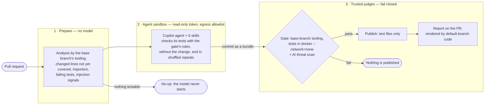
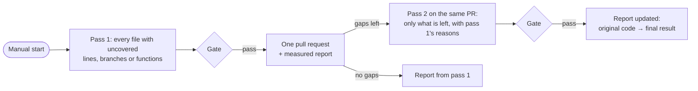

# unit-test-agent tools

Deterministic code around the unit-test agent: it computes what the agent starts
from, checks what the agent produced, decides, and renders the PR report. Node
built-ins only, no install step. The agent lives in [`.github/agents/`](../../.github/agents) and its
skills in [`.github/skills/`](../../.github/skills); how it all fits together is in [`SOLUTION.md`](../../SOLUTION.md).

## How a run flows

The model proposes and deterministic code decides. A run passes through three zones; no zone holds untrusted input, a secret and write access at the same time.



A coverage run (`unit-test-agent-sweep`) works the same way, started by hand, and has up to two passes:



## Where things are

| Path | Role | Used by |
|---|---|---|
| `change-manifest.mjs` | What changed, which changed lines no test covers, existing tests, importers, where old values still appear, the gate | agent job (analyse step), gate |
| `validate-patch.mjs` | Only test files; no forbidden or weakening patterns in added lines; an existing test file may only gain new test cases, any other change to it or to an existing helper must cite a changed source line (PR mode, never in coverage mode); see [Patch checks](#patch-checks) | gate, `judge.sh`, `run-tests.mjs` |
| `fails-without-change.mjs` | How many tests in the agent's test files fail with the PR's modified source files reverted (`fails-without-change.json`) | `measure.sh` |
| `build-report.mjs` | Verdict from measurements only; in PR mode it fails unless a test in the agent's test files fails without the change or every modified source file has a declared exception (always listed); agent-run facts (AI credits, model, skills used, own test runs) are shown but never decide | `judge.sh` |
| `render-comment.mjs` | Sticky PR comment: measured facts first, agent claims sanitised and labelled | report workflow, sweep report job |
| `gate.sh` | Validate, install, apply, measure without network on throwaway copies of the checkout, judge; `MODE=pr` or `coverage` | threat-detection job |
| `measure.sh` | Measures only; runs in the network-less container; see [What the gate runs](#what-the-gate-runs) | gate |
| `judge.sh` | Decides from validation and measurements (plus the session log and usage the gate copied); no PR or agent code | gate |
| `render-report.sh` | Render the comment from the gate's report artifact; reads the publish outcome and the pushed commit from the GitHub API. A PR run that used the model and pushed nothing has no report: the comment then shows the analysis artifact's injection signals and the agent's no-op reason | report workflow, sweep report job |
| `previous-pass.mjs` | A sweep's second pass: the first pass's reasons for files still uncovered, as plain-text notes for the agent | sweep agent job (analyse step) |
| `run-tests.mjs` | The agent's way to run tests: Vitest (and `tsc`) for one app, Prettier for new frontend test files | the agent (base commit's copy in `.unit-test-agent/bin/`) |
| `commit-msg` | Git hook that adds the `Unit-Test-Agent-Run` trailer to the agent's commit (loop guard, report) | agent job |
| `save-evidence.sh` | `<run-id> <slug>`: saves a run's report, claims, usage and links under `docs/agent-runs/`; a run without a patch: gh-aw's safe outputs, usage, the analysis' injection signals and gate, and links. Repository: `GH_REPO`, else the checkout's | run by hand |
| `lib/` | diff parsing, import graph, coverage, Vitest JSON, allowed test paths, patch rules (`patch-rules.mjs`) | — |
| `test/` | Tests for everything here | CI `tooling` job |

The allowed test paths have one source: [`lib/test-paths.mjs`](lib/test-paths.mjs), shared by
`run-tests.mjs` and the gate. The workflows' `allowed-files` list mirrors it.

[`lib/check-output.mjs`](lib/check-output.mjs) checks `agent-output.json` against the base commit's `.github/agents/unit-test-agent.schema.json`: the agent runs it as `run-tests.mjs --check-output` (the workflows install the schema next to it), and the report shows a mismatch as an `Agent output` row that never decides the verdict.

## What the gate runs

`measure.sh` runs twice, each time in its own network-less container on a throwaway copy of the checkout:

1. Baseline, on the commit the agent started from: each app's full suite once, with coverage ("before").
2. With the agent's patch applied, per app:
   - the typecheck once and the full suite once, with coverage ("after");
   - only for an app with test files (`*.test.ts(x)`) in the patch: those files once with `--expect.requireAssertions`,
     those files three more times, and the app's full suite once more in shuffled file and test order
     (the report's "Stability" counts these 1 + 3 + 1 runs);
   - PR mode, when the PR modifies (status `M`) testable source files: those files restored to the merge base,
     the patch's test files once more ("Fails without the change"), then restored.

So for an app with test files in the patch the full suite runs three times (baseline, after, shuffled) and the
typecheck once; only the assertion check, the three repeats and the run without the change use the patch's test
files alone. Coverage percentages are for the files included in each app's Vitest coverage configuration
(`coverage.include` minus `coverage.exclude`), not for every file in the app. The report's "Skills used" and
"Self-review" rows come from the agent's session log: they are shown, never enforced.

## Patch checks

`validate-patch.mjs` reads test code with line-based heuristics, not a parser: string, template, regex and
comment text is blanked, then brackets are matched.

- Every added line: the forbidden patterns in [`lib/patch-rules.mjs`](lib/patch-rules.mjs) (focused or skipped tests,
  snapshots, network, environment, empty `catch` or `.catch(() => {})`, `expect.assertions(0)` and others).
- Every test with added lines: a `return` before its last assertion, and assertions that all sit inside
  `if`/`else`/`switch`/`catch` or after a braceless `if`.
- Existing test files, read from the commit the agent started from: new `it`/`test`/`describe` blocks outside
  existing tests and hooks, new file-scope imports and declarations, and names added to an import are additions.
  Anything else changes existing tests: a removed or edited line, an added line inside an existing test or hook,
  a new hook outside the new blocks, any new `vi.mock` or `vi.hoisted` (hoisted to the top of the file), a new
  file-scope statement or load-time setup call. Existing non-`*.test.*` files under the test paths (fixtures,
  setup helpers) change with any edit. Such a change needs an `assertionChanges` entry citing a changed source
  line in PR mode and is rejected in coverage mode. A file whose original cannot be read, or whose brackets do
  not match, counts as changed.

They do not see assertions made conditional through `&&`, `?:`, loops or helper functions, an early exit through
`throw` or a helper, or a declaration that changes shared state at load time without a setup call; a regex
literal after a value or a multi-line string can mislead the bracket matching. Whether a test asserts at all is
measured at run time (`--expect.requireAssertions`).

## Trust rule

The analysis, the gate and the report never run these files from the pull request: they use the
**base** commit's copy of `tools/unit-test-agent` (the report: the default branch's),
so neither the agent nor an accidental edit to this tooling in a PR changes the rules
that judge the PR. It does not protect against a malicious PR author with write access:
they can edit the workflow file itself. The agent runs the base commit's copy of
`run-tests.mjs`, which the workflow puts into the git-ignored `.unit-test-agent/bin/`
before the agent starts.

In the gate, the agent's tests run only inside a container: no network, the runner's
user, read-only tooling and analysis input, pid, memory and time limits, and a throwaway
copy of the checkout (never the checkout the runner later runs git in). A test can still
forge the measurements it writes; the gate reads them only as plain files under a size
cap. What bounds the damage is that the patch was validated by the base commit's code
before anything ran, and the push is limited to test paths.

## Tests

```sh
npm test --prefix tools/unit-test-agent   # node --test, all of test/
```
